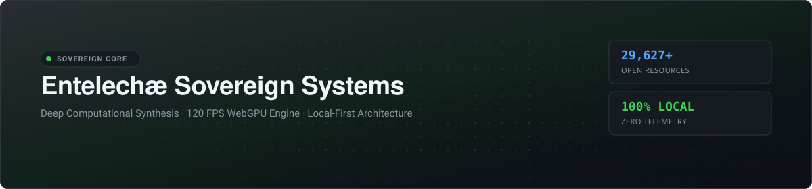
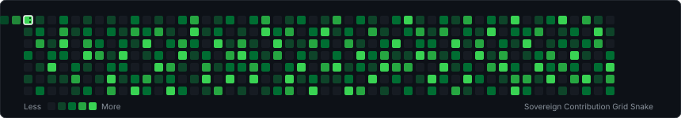

# Entelechæ (`@Entelechae-eng`)

  <!-- Dark Dot Matrix Banner -->
  

### Sovereign Platforms · Deep Computational Synthesis · Generative Systems

> *"Software built to endure. Permanent, local-first, uncompromising."*

---

### ✦ About & Identity

🏛️ **Sovereign Engineering Lab / Indie Systems Creators / Creative Computing Collective**

We build sovereign computing platforms, creative generation tools, and autonomous agent workflows engineered for permanence, client-side data sovereignty, and zero cloud telemetry.

- 🔭 **Building:** 
  - **[Entelechae Code](https://entelechae-code.vercel.app/)** — Sovereign AI developer workbench with local SQLite persistence, interactive code artifacts, and multi-model reasoning.
  - **[Entelechae Visuals](https://entele-visuals.vercel.app/)** — Curating 29,627+ open-source creative resources, 897 motion components, and 683 3D WebGL shader prompts.
  - **[Entelechae Platform](https://github.com/Entelechae-eng/Entelechae-platform)** — Decentralized sovereign substrate and native 120 FPS WebGPU canvas engine.
  - **[Entele-motion](https://github.com/Entelechae-eng/Entele-motion)** — Universal code-driven generative cinema, motion graphics, and audio synthesis studio.
- 🤖 **Agentic & Tooling:** Tinkering with autonomous coding agents, custom skills, browser automation (CDP), and Model Context Protocol (MCP) servers.
- ⚡ **Core Philosophy:** Local-first execution, deterministic state replay, and century-scale architectural permanence.

---

### ✦ Tech Stack

- **Languages:** TypeScript, JavaScript, Rust, Python, Bun, Node.js
- **Frontend & Graphics:** React 19, Next.js 16, WebGPU, WebGL, Tailwind CSS v4, Framer Motion, Lenis Smooth Scroll
- **Local & Sovereign State:** SQLite, Cryptographic Key Vaults, Local-First Sync, Zero Telemetry
- **Agentic Infrastructure:** Model Context Protocol (MCP), Multi-Model Workflows (Claude 3.5, Gemini, DeepSeek, Local Ollama)
- **DevOps & Systems:** Docker, Linux, GitHub Actions, Edge Compute, Vercel

---

### ✦ Projects (`Projects / 核心平台`)

| Project | Category | Description | Stack | Status |
| :--- | :--- | :--- | :--- | :--- |
| **[Entelechae Platform](https://github.com/Entelechae-eng/Entelechae-platform)** | Sovereign Substrate | Deep computational synthesis, high-density editorial interface, and 120 FPS WebGPU canvas engine. | `Next.js 16` `React 19` `WebGPU` `TypeScript` |  |
| **[Entelechae Visuals](https://github.com/Entelechae-eng/Entele-visuals)** | Creative Architecture | 29,627+ open-source creative resources, 897 motion components, and 683 3D WebGL shader prompts. | `React 19` `Tailwind v4` `WebGL` `Framer Motion` |  |
| **[Entelechae Code](https://entelechae-code.vercel.app/)** | Sovereign AI Workbench | Multi-model AI developer environment with local SQLite state, live interactive code artifacts, and zero SaaS telemetry. | `TypeScript` `SQLite` `MCP` `React` |  |
| **[Entele-motion](https://github.com/Entelechae-eng/Entele-motion)** | Generative Cinema | Universal code-driven generative cinema, motion graphics, and voice studio tool. | `TypeScript` `Canvas/GL` `Audio API` |  |
| **[Atelier Studio](https://github.com/Entelechae-eng)** | Creative Workspace | Native 120 FPS WebGPU creative workspace with local cryptographic vaults and deterministic state replay. | `WebGPU` `Wasm` `Rust` `TypeScript` |  |

---

### ✦ Activity & Contribution Snake Game

<!-- GitHub Contribution Grid Snake Game (Same as Ikaleio) -->
<picture>
  <source media="(prefers-color-scheme: dark)" srcset="https://raw.githubusercontent.com/Entelechae-eng/Entelechae-platform/main/.github/assets/github-snake-dark.svg">
  <source media="(prefers-color-scheme: light)" srcset="https://raw.githubusercontent.com/Entelechae-eng/Entelechae-platform/main/.github/assets/github-snake.svg">
  
</picture>

  
  

  

---

### ✦ Connect & Ecosystem

- 🌐 **Official Platform:** [entelechae.com](https://github.com/Entelechae-eng/Entelechae-platform)
- 🎨 **Visuals Hub:** [entele-visuals.vercel.app](https://entele-visuals.vercel.app/)
- 💻 **AI Workbench:** [entelechae-code.vercel.app](https://entelechae-code.vercel.app/)
- 🐙 **GitHub Organization:** [@Entelechae-eng](https://github.com/Entelechae-eng)
- ✉️ **Inquiries & Security:** [SECURITY.md](https://github.com/Entelechae-eng/Entelechae-platform/blob/main/SECURITY.md)

Crafted with sovereign care by the Entelechæ Engineering Collective. Designed to endure for the 100-year horizon.

