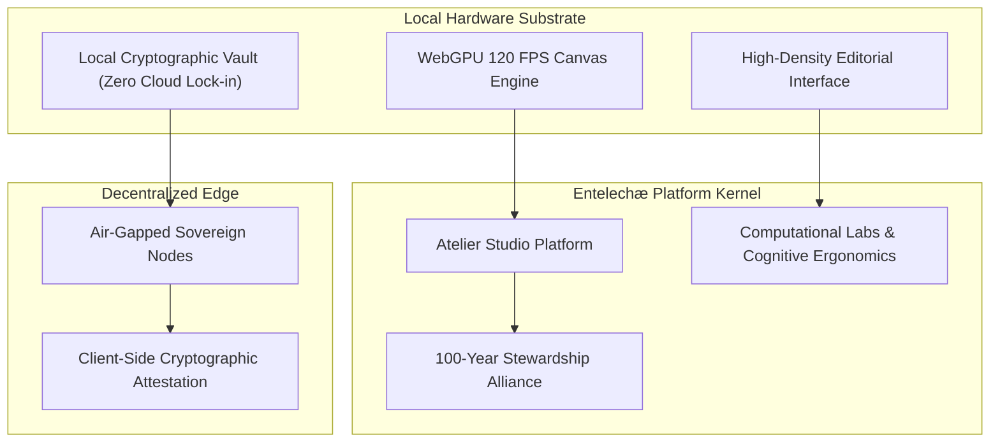

# Entelechæ Sovereign Platform

<div align="center">

```
  ███████╗███╗   ██╗████████╗███████╗██╗     ███████╗ ██████╗██╗  ██╗ █████╗ ███████╗
  ██╔════╝████╗  ██║╚══██╔══╝██╔════╝██║     ██╔════╝██╔════╝██║  ██║██╔══██╗██╔════╝
  █████╗  ██╔██╗ ██║   ██║   █████╗  ██║     █████╗  ██║     ███████║███████║█████╗  
  ██╔══╝  ██║╚██╗██║   ██║   ██╔══╝  ██║     ██╔══╝  ██║     ██╔══██║██╔══██║██╔══╝  
  ███████╗██║ ╚████║   ██║   ███████╗███████╗███████╗╚██████╗██║  ██║██║  ██║███████╗
  ╚══════╝╚═╝  ╚═══╝   ╚═╝   ╚══════╝╚══════╝╚══════╝ ╚═════╝╚═╝  ╚═╝╚═╝  ╚═╝╚══════╝
```

**Independent Technology Company · Sovereign Platforms & Deep Computational Synthesis**

[](https://nextjs.org/)
[](https://react.dev/)
[](https://www.typescriptlang.org/)
[](https://tailwindcss.com/)
[](https://www.w3.org/TR/webgpu/)
[](LICENSE)

[Architecture](#architecture) • [Platforms](#platform-ecosystem) • [Engineering Stack](#engineering-stack) • [Quick Start](#quick-start) • [Security](#security--privacy) • [Stewardship](#founding-stewards)

</div>

---

## Overview

**Entelechæ** is an independent parent technology company building sovereign platforms, computational synthesis, and foundational software for what gets built next. We measure our horizon in decades, crafting systems designed for permanence, local privacy, and uncompromising performance.

Our premier creation, **Atelier Studio**, is a native 120 FPS WebGPU creative workspace engineered from first principles—offering local-first cryptographic storage, deterministic state replay, and zero telemetry cloud dependencies.

---

## Architectural Principles



1. **Local-First Sovereignty**: Computations, canvas states, and secret keys execute client-side via hardware-accelerated WebGPU and WebAssembly.
2. **Zero Cloud Telemetry**: Absolute respect for user attention and privacy. No tracking beacons, surveillance analytics, or vendor lock-in.
3. **Deterministic Permanence**: Systems built to endure for 100-year horizons with full operational autonomy and offline execution.
4. **Cinematic Craftsmanship**: Minimalist, dark-mode visual hierarchy inspired by world-class architectural and editorial standards.

---

## Platform Ecosystem

| Initiative | Classification | Status | Target Horizon |
| :--- | :--- | :--- | :--- |
| **Atelier Studio** | Flagship Creative Workspace | Production V1.0 | 2026–2036 |
| **Sovereign Engine** | Zero-Dependency Runtime & Substrate | Private Alpha | 2026–2040 |
| **Computational Labs** | Generative Synthesis & Ergonomics | Ongoing Research | 100-Year Horizon |
| **Sovereign Escrow** | Zero-Telemetry Data Vault | Active Alpha | 2025–2035 |
| **Parent Foundation** | Patient Capital & Stewardship | Active Governance | Indefinite |

---

## Engineering Stack

- **Runtime & Framework**: [Next.js 16](https://nextjs.org/) (App Router, Webpack/Turbopack, Static Pre-rendering)
- **UI Library**: [React 19](https://react.dev/) with React Server Components (RSC)
- **Styling**: [Tailwind CSS v4](https://tailwindcss.com/) with pure `#000000` dark-mode tokens
- **Motion & Micro-interactions**: [Framer Motion](https://www.framer.com/motion/) & [Lenis Smooth Scroll](https://github.com/darkroomengineering/lenis)
- **State Synchronization**: Pure external store subscriptions (`useSyncExternalStore`) for zero-drift live clocks
- **Type Safety**: 100% Strict [TypeScript 5](https://www.typescriptlang.org/)
- **Security & Headers**: OWASP Top-10 headers (HSTS, CSP, COOP, Permissions-Policy, X-Frame-Options)

---

## Quick Start

### Prerequisites
- Node.js `^20.10.0` or `^22.0.0`
- npm `^10.0.0` (or pnpm `^9.0.0`)

### Installation

```bash
# Clone the repository
git clone https://github.com/Entelechae-eng/Entelechae-platform.git
cd Entelechae-platform

# Install production dependencies
npm install

# Configure environment variables (optional for local mock mode)
cp .env.example .env.local

# Run local development server
npm run dev
```

Open [http://localhost:3000](http://localhost:3000) with your browser to experience the sovereign platform.

### Verification & CI Commands

```bash
# Static analysis and linting (0 warnings enforced)
npm run lint

# TypeScript verification
npm run typecheck

# Production build and static page compilation
npm run build
```

---

## Project Structure

```
entelechae-platform/
├── .github/
│   └── workflows/
│       └── ci.yml             # Automated CI pipeline
├── app/
│   ├── api/                   # Hardened REST endpoints
│   ├── careers/               # Stewardship & engineering roles
│   ├── company/               # Parent foundation & manifesto
│   ├── contact/               # Encrypted direct correspondence
│   ├── legal/                 # Sovereign terms & privacy charter
│   ├── not-found.tsx          # Minimal 404 page
│   ├── platforms/             # Platform portfolio & Atelier case study
│   ├── research/              # Computational synthesis research papers
│   ├── globals.css            # Dark mode tokens & typography presets
│   ├── layout.tsx             # Root layout with SmoothScroll & Navbar
│   ├── page.tsx               # Full-screen Ekon hero & sovereign home
│   ├── robots.ts              # SEO crawler directives
│   └── sitemap.ts             # Static sitemap generator
├── components/
│   ├── layout/                # Navbar, Footer, SmoothScroll
│   └── ui/                    # EkonLoader, LiveClock, WorldClock, Faq
├── lib/                       # Rate limiter, Supabase admin, utilities
├── public/                    # High-fidelity RGB images and assets
├── next.config.ts             # Security headers, CSP & performance flags
├── tsconfig.json              # Strict TypeScript compiler options
└── package.json               # Manifest & scripts
```

---

## Security & Privacy

Entelechæ enforces a zero-trust, privacy-first posture across all platform layers:
- **Strict Transport Security (HSTS)**: 2-year preloaded HTTPS requirement.
- **Cross-Origin Opener Policy (COOP)**: Complete tab isolation.
- **No Third-Party Telemetry**: Zero marketing pixels, zero user profiling cookies.
- **Input Sanitization**: Content-type, length limits, honeypot defenses, and IP rate-limiting.

Review our responsible disclosure policy at [SECURITY.md](SECURITY.md).

---

## Deployment

The application is fully optimized for edge deployment:

### Deploy to Vercel

[](https://vercel.com/new/clone?repository-url=https://github.com/Entelechae-eng/Entelechae-platform)

```bash
npm install -g vercel
vercel deploy --prod
```

### Self-Hosted Docker / Node Container

```bash
npm run build
npm run start
```

---

## Founding Stewards

- **Sahurain** — Co-Founder & Founding Steward (`sahurain15@gmail.com`)
- **Tantresh Sahu** — Co-Founder & Founding Steward (`entelechae@gmail.com`)

*Nodes anchored across New Delhi and San Francisco.*

---

## License

This project is licensed under the [MIT License](LICENSE).  
© 2026 Entelechæ. All rights reserved.
